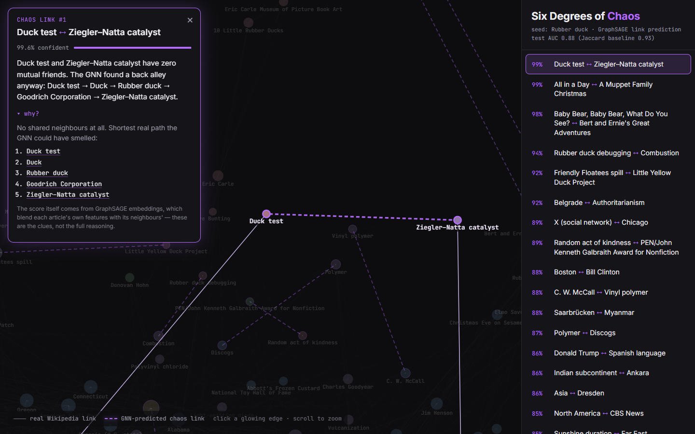

# Six Degrees of Chaos 🦆

**A graph neural network reads 400 Wikipedia articles around _Rubber duck_, learns what a link looks like, then goes looking for the links nobody ever wrote.**

It's convinced *Duck test* belongs next to *Ziegler–Natta catalyst*. It wants *Rubber duck debugging* to meet *Combustion*. It thinks *Belgrade* and *Authoritarianism* have unfinished business. Click a glowing edge and it'll tell you why.



> Built in a single 3-hour session: crawl → graph → GNN → API → interactive frontend.

## What it does

1. **Crawls** a real slice of Wikipedia: BFS from *Rubber duck* to depth 2, capped at 400 articles, ~7,800 real links.
2. **Trains a GNN** to predict whether two articles are linked.
3. **Scores every pair that *isn't* linked** (~72k of them) and keeps the 20 most confident "chaos" links.
4. **Shows it all** as an interactive force-directed graph. Real links are faint gray lines; predicted links are dashed, glowing purple. Click one to get the confidence, a snarky caption, and the evidence behind it.

## How the GNN works (the 3-sentence version)

Each article starts as a tiny vector of structural facts: how many links it has, how long it is, how clustered its neighbourhood is, its PageRank, and how far it sits from the seed. Two GraphSAGE layers let every article repeatedly average in its neighbours' vectors, so after training each article's 64-d embedding encodes *the kind of neighbourhood it lives in*, not just itself. The model scores a pair by the dot product of their embeddings and is trained on real links vs. random non-links, so a high score on a pair that *isn't* linked means "these two live in suspiciously compatible neighbourhoods."

## Results, honestly

| Model | Test ROC-AUC (held-out real links) |
|---|---|
| 2-layer GraphSAGE + dot-product decoder | **0.88** |
| Jaccard coefficient (shared-neighbour heuristic) | **0.93** |

**The simple heuristic wins on AUC.** On a small, dense, navbox-heavy graph, "do they share a lot of neighbours?" is an extremely strong signal, and the GNN only sees cheap structural features (no article text).

So why use the GNN for the predictions? **Jaccard can only score pairs that already share neighbours.** For a pair with zero mutual links it returns exactly 0, so it can never suggest a surprising connection. The GNN generalises through embedding similarity, and 7 of the top 20 predictions have **zero** shared neighbours (11 have at most one). Those are precisely the "absurd but plausible" links this project exists to find. The pipeline also *deliberately rejects* pairs with high Jaccard overlap: if a heuristic would already predict it, it's not chaos.

The obvious next step would be text features (e.g. sentence embeddings of each article's intro). That should lift the GNN above the heuristic, since topic similarity is something Jaccard can't see.

## How a "chaos link" gets chosen

Raw top-scoring pairs are mostly boring (Germany ↔ Reuters) or one cluster talking to itself (20 variations of Muppets ↔ Eric Carle books). `predict.py` keeps a pair only if it is:

- **cross-community**: the endpoints sit in different Louvain communities
- **low-overlap**: Jaccard ≤ 0.12, so the GNN is seeing something a heuristic doesn't
- **not hub ↔ hub**: at least one endpoint has ≤ 50 links
- **not a title echo**: no *Bering Strait* ↔ *Bering Sea*
- **fresh**: each article appears once, and each community pair at most twice

The "why?" panel shows the most specific shared neighbours. If there are none, it shows the shortest real path between the two articles: the trail of breadcrumbs the GNN's message passing could have followed.

## Run it

**Backend** (Python 3.11+):

```bash
cd backend
python -m venv .venv && source .venv/bin/activate      # Windows: .venv\Scripts\activate
pip install torch --index-url https://download.pytorch.org/whl/cpu
pip install -r requirements.txt

# Offline pipeline (all outputs land in backend/data/). raw_graph.json is committed,
# so you can skip the crawl. Each later step takes seconds on a CPU.
python crawl.py          # optional: re-crawl ("python crawl.py Napoleon" for another seed)
python build_graph.py    # -> graph.pt, graph.json
python train.py          # -> model.pt, metrics.json
python predict.py        # -> predictions.json

uvicorn app:app --port 8000
```

**Frontend** (Node 20+):

```bash
cd frontend
npm install
npm run dev        # http://localhost:5173 (proxies /api to :8000)
# or: npm run build, and the FastAPI server serves the app at http://localhost:8000
```

## API

| Endpoint | Returns |
|---|---|
| `GET /api/graph` | `{ seed, nodes: [{ id, depth, degree, group, url }], edges: [{ source, target }] }` |
| `GET /api/predictions` | `[{ rank, source, target, confidence, caption, shared_neighbors, shared_count, path }]` |
| `GET /api/metrics` | `{ val_auc, test_auc, jaccard_test_auc, epochs }` |

Everything is precomputed. The server does no crawling and no inference per request; it just serves JSON.

## Stack

Python · Wikipedia MediaWiki API · networkx · PyTorch · PyTorch Geometric (GraphSAGE, `RandomLinkSplit`) · FastAPI · React + Vite · react-force-graph-2d

## Project layout

```
backend/
  crawl.py         BFS crawl via the MediaWiki API (cached to disk)
  build_graph.py   networkx graph, node features, Louvain communities, PyG Data
  train.py         GraphSAGE link predictor + Jaccard baseline
  predict.py       score non-edges, filter for chaos, write captions
  app.py           FastAPI: /api/graph, /api/predictions, /api/metrics
  data/            pipeline outputs
frontend/src/
  App.jsx                landing, loading, error states
  GraphView.jsx          force graph, real vs. predicted edge rendering
  PredictionSidebar.jsx  ranked predictions (bottom sheet on mobile)
  PredictionCard.jsx     confidence, caption, "why?"
```
